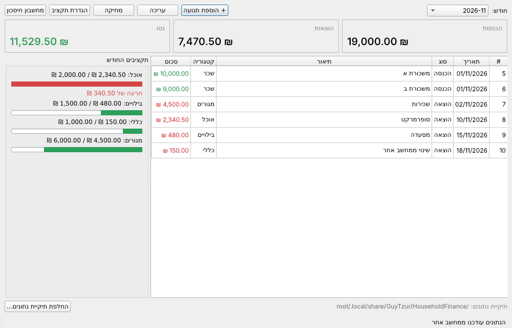

# HouseholdFinanceTracker


A C++17 application for managing a household's monthly budget: recording income and expenses, tracking spending against per-category budgets, and forecasting how long it will take to reach a savings goal. It comes as a **desktop app (Qt)** for macOS and Windows and as a command-line app, both built on the same core library.



I built it for my brother and his partner to manage their household finances, and used it to practise writing C++ the way it is written in real projects: separated layers, input validation, unit tests and continuous integration.

## Features

- **Income and expenses**: add, edit and delete transactions (description, amount, category, date)
- **Monthly report**: income, expenses and net balance for any month, with spending per category
- **Category budgets**: set a monthly budget per category; get a warning as soon as an expense goes over it
- **Savings forecast**: estimates how many months it will take to reach a goal, based on the average monthly savings
- **Persistent storage**: data is saved to CSV files after every change, with atomic writes so a crash cannot corrupt the data
- **Desktop app**: a Qt window with a monthly table, budget progress bars and dialogs for adding and editing
- **Shared data between computers**: the data folder can be put in iCloud Drive, Google Drive, Dropbox or OneDrive; the app reloads automatically when the files change on another computer
- **Robust input handling**: invalid numbers, menu choices and dates are rejected with a clear message; malformed lines in the data files are skipped with a warning instead of crashing the program

## Example

```
=========================================
דו"ח חודשי: 2026-11
=========================================
הכנסות:  19,000.00 ש"ח
הוצאות:  6,840.50 ש"ח
נטו:     12,159.50 ש"ח
-----------------------------------------
מצב תקציבים:
* אוכל: 2,340.50 / 2,000.00 ש"ח  <-- חריגה של 340.50 ש"ח
* בילויים: 0.00 / 1,500.00 ש"ח
* כללי: 0.00 / 1,000.00 ש"ח
* מגורים: 4,500.00 / 6,000.00 ש"ח
=========================================
```

(The user interface is in Hebrew, since the app was built for a Hebrew-speaking household.)

## Architecture

The code is split into layers, each with one responsibility:

```
gui/MainWindow (Qt) ─┐
                     ├──> FinanceManager ──> Transaction, Money, Validation
ConsoleApp ──────────┤
                     └──> FileStorage
```

Both front ends use the same `finance_core` library. Adding the desktop app did not require any change to the business logic, which is the point of keeping `FinanceManager` free of input and output.

| File | Responsibility |
|---|---|
| `Transaction.h` | The `Transaction` struct and the `TransactionType` enum |
| `Money.h/.cpp` | Parsing and formatting amounts; money is stored as integer agorot |
| `Validation.h/.cpp` | Pure validation helpers: dates (including leap years), text sanitizing |
| `FinanceManager.h/.cpp` | Business logic: transactions, monthly summaries, budgets, savings forecast. **No input/output at all** |
| `FileStorage.h/.cpp` | Loading and saving CSV files |
| `InputUtils.h/.cpp` | Reading validated input from the console |
| `ConsoleApp.h/.cpp` | The menu and all printing |
| `main.cpp` | Console app entry point |
| `gui/MainWindow.h/.cpp` | Desktop app main window: table, summary, budgets, file watching |
| `gui/TransactionDialog.h/.cpp` | Desktop app form for adding and editing a transaction |

### Design decisions

- **Money as integers, not `double`.** Amounts are stored in agorot as `long long`. Floating-point numbers cannot represent most decimal fractions exactly (`0.1 + 0.2 != 0.3`), which leads to rounding errors in financial sums. Integers are exact.
- **Business logic separated from I/O.** `FinanceManager` never touches `cin`, `cout` or files. That is what makes it unit-testable, and it means the same logic could later be used behind a GUI or a web API without changes.
- **Validation in one place.** `FinanceManager` validates every transaction and throws `std::invalid_argument` on bad data, so invalid data cannot get in regardless of where it comes from.
- **Atomic saves.** Data is written to a temporary file which then replaces the real file with `std::rename`, so an interrupted save never leaves a half-written file.
- **Sync through a shared folder instead of a server.** Two computers share data by pointing the app at the same cloud-synced folder. `QFileSystemWatcher` watches the folder (not only the files, because both the app and sync services replace files by renaming), and the app reloads when another computer changes them. Simple and free, at the cost that if both computers save at the same moment, the last save wins.
- **Portable file handling.** Paths are `std::filesystem::path`, so folders with non-English names work on Windows, and saving uses `std::filesystem::rename`, which replaces the old file on every platform (the C `rename` fails on Windows when the target exists).
- **Forgiving loading.** A corrupted line in a data file is skipped and reported, rather than crashing the program or discarding all the data.

## Download

Ready-to-run builds for macOS (`.dmg`) and Windows (`.zip`) are attached to each [release](https://github.com/guytzur13/HouseholdFinanceTracker/releases). The builds are not code-signed, so the first time: on macOS right-click the app and choose **Open**; on Windows click **More info → Run anyway**.

To share data between computers, click **Change data folder...** in the app on both computers and choose the same cloud-synced folder.

## Build and run

Requirements: a C++17 compiler, CMake 3.16+, and Qt 6 for the desktop app (`brew install qt` on macOS). Without Qt, only the console app and the tests are built.

```bash
cmake -S . -B build
cmake --build build
./build/HouseholdFinance.app/Contents/MacOS/HouseholdFinance   # desktop app (macOS)
./build/finance_tracker                                        # console app
```

On the first run, sample data for two months is created. Data is stored in `transactions.csv` and `budgets.csv` in the working directory (both are git-ignored).

An Xcode project is also included: open `HouseholdFinanceServer.xcodeproj` and press Run.

## Tests

The logic is covered by unit tests written with [GoogleTest](https://github.com/google/googletest) (downloaded automatically by CMake):

```bash
ctest --test-dir build --output-on-failure
```

The tests cover money parsing and formatting, date validation (including leap years), monthly summaries, budget overruns, the savings forecast, editing and deleting, and saving and loading files, including corrupted input. GitHub Actions runs the build and all tests on every push.

## Roadmap

- [x] Split the code into separate files and layers
- [x] Robust input handling
- [x] Monthly reports and per-month budgets
- [x] Edit and delete transactions
- [x] Configurable budgets saved to a file
- [x] Unit tests and CI
- [x] Desktop app for macOS and Windows (Qt)
- [x] Shared data between computers through a synced folder
- [ ] Recurring transactions (e.g. rent every month)
- [ ] Charts of spending over time
- [ ] Export a monthly report to a file

## Author

Guy Tzur, Computer Science student at Colman.
